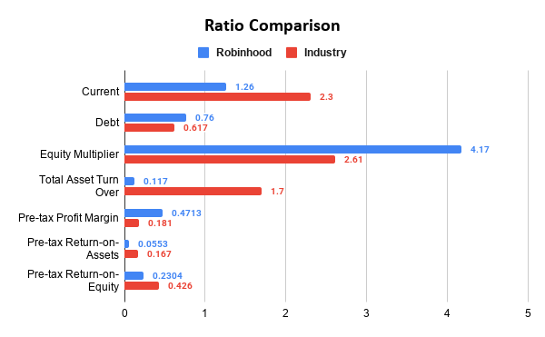

# Robinhood: Financial Health & Industry Benchmark Analysis

## Overview

This project evaluates Robinhood Markets, Inc.'s financial health by analyzing financial ratios and comparing the company's performance with industry benchmarks.

Using financial statement figures identified in the project report and industry data from RMA's NAICS 523150 category, *Investment Banking and Securities Intermediation*, the analysis examines liquidity, financial leverage, asset utilization, and profitability.

The objective is to identify Robinhood's relative financial strengths, highlight areas of concern, and develop recommendations based on the comparison.

## Project Objectives

This analysis seeks to answer the following questions:

- How does Robinhood's financial position compare with industry benchmarks?
- Does the company demonstrate sufficient short-term liquidity?
- How heavily does Robinhood rely on liabilities to finance its assets?
- How efficiently does the company generate revenue from its asset base?
- How does Robinhood's profitability compare with the industry benchmark?
- Which financial metrics represent the greatest opportunities or risks?

## Tools & Skills

- **Financial Statement Analysis:** Interpreting balance sheet and income statement figures.
- **Financial Ratio Analysis:** Calculating liquidity, leverage, asset turnover, and profitability ratios.
- **Industry Benchmarking:** Comparing company performance with RMA industry data.
- **Comparative Analysis:** Measuring differences between company metrics and industry benchmarks.
- **Business Analysis:** Interpreting results, identifying financial risks, and developing recommendations.
- **Financial Research:** Using company financial disclosures and industry benchmark information.

## Data Sources & Industry Classification

The project uses Robinhood financial statement figures identified in the report and industry benchmarks from RMA.

- **Company:** Robinhood Markets, Inc.
- **Company classification:** SEC SIC 6211 — Security Brokers, Dealers & Flotation Companies.
- **Benchmark classification:** NAICS 523150 — Investment Banking and Securities Intermediation.
- **Benchmark period:** April 1, 2024 – March 31, 2025, using the RMA "ALL" column as documented in the analysis.
- **Company reporting source:** Robinhood's 2025 Form 10-K, as referenced in the original report.

The analysis compares the company ratios with the selected industry benchmarks. Differences in business models, accounting classifications, and ratio definitions may affect comparability.

## Financial Ratio Comparison

| Metric | Robinhood | RMA Benchmark | Assessment |
|---|---:|---:|---|
| Current ratio | 1.26 | 2.30 | Below benchmark |
| Debt ratio | 76.0% | 61.7% | Higher leverage |
| Equity multiplier | 4.17x | 2.61x | Higher leverage |
| Total asset turnover | 0.117x | 1.70x | Below benchmark |
| Pre-tax profit margin | 47.13% | 18.1% | Above benchmark |
| Pre-tax return on assets | 5.53% | 16.7% | Below benchmark |
| Pre-tax return on equity | 23.04% | 42.6% | Below benchmark |

The ratios are reported using the figures and definitions documented in the original analysis.

## Methodology

The analysis follows these steps:

1. Identify the financial statement values used for Robinhood's ratio calculations.
2. Calculate the current ratio to assess short-term liquidity.
3. Calculate the debt ratio and equity multiplier to evaluate financial leverage.
4. Calculate total asset turnover to assess revenue generation relative to the asset base.
5. Calculate pre-tax profit margin, pre-tax return on assets, and pre-tax return on equity.
6. Compare each company ratio with the selected RMA industry benchmark.
7. Interpret the differences and identify financial strengths, risks, and potential areas for improvement.

## Key Findings

### 1. Profit Margin Is a Relative Strength

Robinhood's pre-tax profit margin of 47.13% exceeds the 18.1% industry benchmark by 29.03 percentage points.

This indicates that a comparatively large proportion of the revenue used in the analysis remains as pre-tax earnings after the expenses reflected in earnings before taxes.

### 2. Liquidity Is Below the Benchmark

Robinhood's current ratio of 1.26 is below the benchmark of 2.30.

Current assets exceed current liabilities, but the company's relative liquidity is weaker than the selected benchmark. This makes short-term liquidity an area worth monitoring.

### 3. Financial Leverage Is Higher

Robinhood's debt ratio is approximately 76%, compared with the benchmark of approximately 61.7%. Its equity multiplier is also higher, at 4.17x versus 2.61x.

These results indicate greater reliance on liabilities relative to assets and equity than the benchmark suggests.

### 4. Asset Turnover Is Substantially Lower

Robinhood's total asset turnover is 0.117x, compared with the industry benchmark of 1.70x.

Based on these ratios, Robinhood generates less reported revenue per dollar of assets than the benchmark. This difference merits further investigation, including consideration of business-model differences and how revenue and assets are defined for the company and industry group.

### 5. Returns on Assets and Equity Are Below Benchmarks

Robinhood's pre-tax return on assets is 5.53%, compared with 16.7% for the benchmark. Its pre-tax return on equity is 23.04%, compared with 42.6%.

Despite its strong pre-tax profit margin, the company generates lower pre-tax returns relative to its asset and equity bases than the selected benchmark.

## Recommendations

Based on the analysis, the following areas warrant further evaluation:

- **Asset utilization:** Investigate opportunities to generate additional revenue from existing assets and improve asset productivity.
- **Financial leverage:** Evaluate the company's liability structure and potential ways to reduce financial risk.
- **Liquidity management:** Monitor current assets and liabilities to maintain sufficient capacity to meet short-term obligations.
- **Returns on capital:** Assess how earnings and the deployment of assets and equity could be improved.
- **Benchmark comparability:** Confirm that the industry benchmark and company ratios use sufficiently comparable definitions before making decisions based on the size of the differences.

These recommendations identify areas for further investigation; they do not establish that a specific operational or financing change would necessarily improve performance.

## Conclusion

The analysis presents a mixed picture of Robinhood's financial health. Its pre-tax profit margin is substantially above the selected industry benchmark, while its current ratio, asset turnover, pre-tax return on assets, and pre-tax return on equity are below their respective benchmarks.

The company also exhibits higher financial leverage than the benchmark. Together, these results suggest that asset utilization, liquidity, capital structure, and returns on the asset and equity base deserve further evaluation.

## Files

- `robinhood_financial_health_industry_benchmark_analysis.pdf` - Final report in PDF format.
- `robinhood_financial_health_industry_benchmark_analysis.docx` - Editable report.
- `images/ratio_comparison.png` - Visual summarizing company ratios and industry benchmarks.

## Skills Demonstrated

Financial Statement Analysis · Financial Ratio Analysis · Industry Benchmarking · Liquidity Analysis · Financial Leverage · Profitability Analysis · Asset Utilization · Financial Research · Comparative Analysis · Business Recommendations
